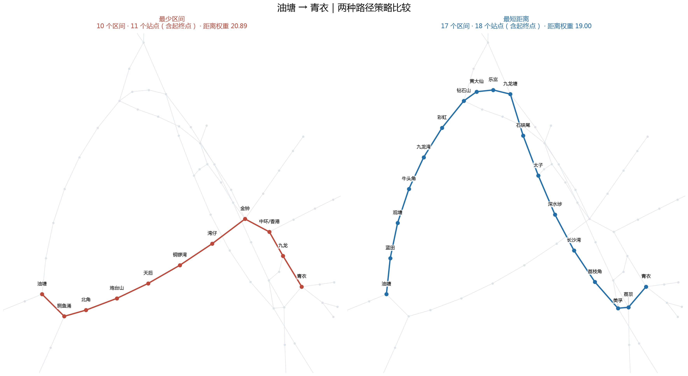
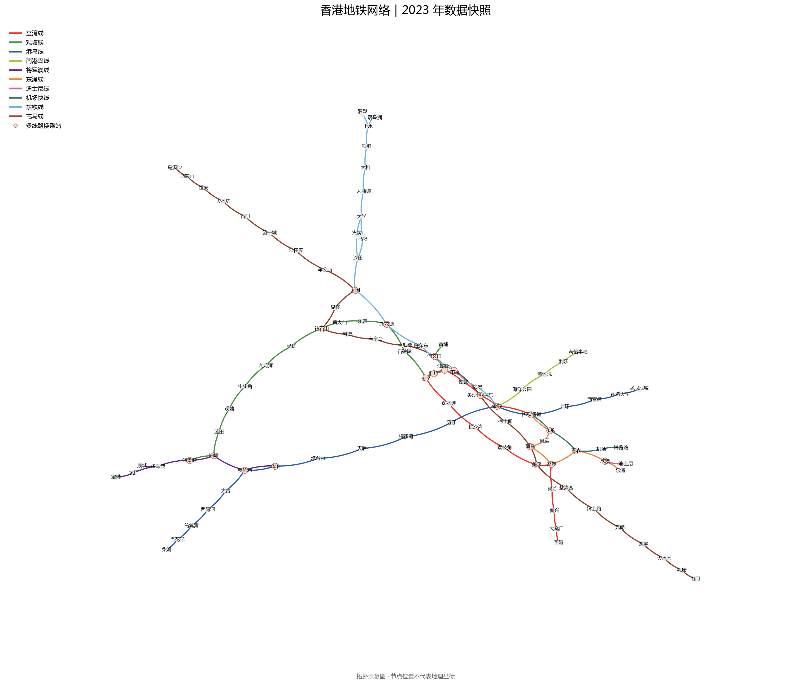

# Hong Kong Metro Route Analysis

用 Python、NetworkX 和 Matplotlib 构建香港地铁多重图，对比**最少乘车区间**与**最短距离**两种路径策略，并可视化线路与换乘站。

项目使用 **2023-02-01 的原始数据快照**，包含 10 条线路、96 个建模节点和 112 条连接。它是一个图建模与路径分析项目；站点数受合并站点等建模假设影响，不代表当前港铁站点统计。

## 路径比较：油塘 → 青衣



| 策略 | 算法 | 乘车区间数 | 站点数（含起终点） | 距离权重 |
| --- | --- | ---: | ---: | ---: |
| 最少区间 | 无权最短路径 / BFS | 10 | 11 | 20.89 |
| 最短距离 | Dijkstra | 17 | 18 | 19.00 |

按当前数据，最短距离策略比示例中的最少区间路线多经过 7 个区间，但累计距离权重更小。优化目标不同，会得到不同的路线。

- **最少区间：** 油塘 → 鲗鱼涌 → 北角 → 炮台山 → 天后 → 铜锣湾 → 湾仔 → 金钟 → 中环/香港 → 九龙 → 青衣
- **最短距离：** 油塘 → 蓝田 → 观塘 → 牛头角 → 九龙湾 → 彩虹 → 钻石山 → 黄大仙 → 乐富 → 九龙塘 → 石硖尾 → 太子 → 深水埗 → 长沙湾 → 荔枝角 → 美孚 → 荔景 → 青衣

区间数等于路径节点数减一。距离由数据自动累计；在多条线路连接同一对站点时，每段取最小距离权重，与 NetworkX 的加权最短路径语义一致。最少区间可能存在多条并列路线，BFS 返回其中一条，不保证这条路线在并列方案中距离最短。

## 网络建模与可视化



- 使用无向 `MultiGraph`，保留不同线路连接同一对站点的平行边。
- 同名站点共用一个节点，因此不同线路在该站自然连通。每条边显式保存线路编号、名称、颜色和距离权重，每个节点记录所属线路。
- 按站点所属线路识别换乘站。同一线路的分支站（如上水、将军澳）不会仅因连接多个方向而被误标。
- 共线路段以不同颜色的弧线表示；两种路径分别绘制，避免重合部分互相覆盖。
- 使用固定随机种子的拓扑布局，不需要安装 Graphviz。节点位置和图上边长不代表地理坐标或实际距离。

## 运行

推荐 Python 3.11 或以上。在仓库根目录执行：

```bash
python -m venv .venv
source .venv/bin/activate
python -m pip install -r requirements.txt
python -m jupyterlab Hong_Kong_Metro_test.ipynb
```

Windows 的环境激活命令为 `.venv\Scripts\activate`。

在 JupyterLab 中选择此虚拟环境对应的 Python 内核，然后从头运行全部单元格。Notebook 会显示分析结果，并将两张图片保存到 `images/`。

中文标签需要系统安装中文字体。程序会自动选择常见字体；如果提示缺少字体，可以安装 Noto Sans CJK SC 并重启内核。

只查询路径也可以直接使用：

```python
from metro import compare_routes, load_network

graph = load_network()
for result in compare_routes(graph, "油塘", "青衣"):
    print(result["strategy"], result["segment_count"], result["distance"])
    print(" → ".join(result["path"]))
```

运行检查：

```bash
python -m unittest discover -s tests -v
```

检查覆盖共线路段的线路归属、分支站识别、示例路径指标、平行边距离选择、同站查询、未知及不可达站点，以及无效数据输入。

## 数据与边界

原始文件保留 UTF-16 编码：

| 文件 | 内容 | 原始文件标注的来源 |
| --- | --- | --- |
| `Hong_Kong_Metro_Lines_ZHCN.txt` | 线路编号、名称、颜色 | 港铁官网 |
| `Hong_Kong_Metro_Routes_ZHCN.txt` | 相邻站点、距离权重、线路编号 | 维基百科 |

原始文件未记录具体来源页面及版本，本次整理未更新线路或重新核验距离。距离权重沿用原始数值，不能视为行程时间。

建模沿用原项目的简化：

- 中环/香港、尖沙咀/尖东分别合并为一个节点，未计算站内步行距离。
- 不含高铁和轻铁；机场快线包含在数据中，但未建模其乘车及换乘限制。
- 未考虑候车时间、运行时间、换乘成本、票价、方向和班次，线路按双向可通行处理。
- 马场站相邻连接保留原数据增加的 `0.001` 权重，这是启发式调整，不能替代特殊班次建模。
- 换乘站标注表示多条线路在模型中相交；当前路径查询不计算实际换乘次数，也不提供最快到达策略。

## 仓库结构

```text
Hong_Kong_Metro_test.ipynb       分步讲解、路径比较与图片导出
metro.py                       数据读取、建图、路径计算和绘图
Hong_Kong_Metro_Lines_ZHCN.txt   原始线路数据
Hong_Kong_Metro_Routes_ZHCN.txt  原始站间连接数据
images/                        README 使用的示例图片
tests/test_metro.py             核心行为检查
requirements.txt               运行依赖
```

原始探索完成于 2023 年。本次整理保留原数据与两种路径策略，补充线路属性、修正换乘站识别和结果表达，并改善运行与展示方式。
